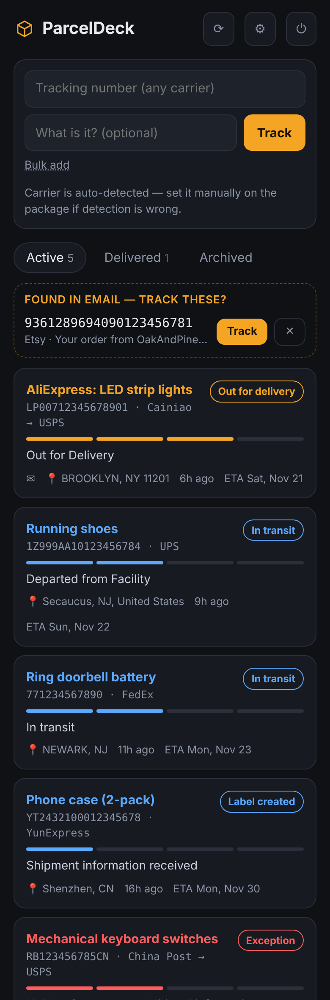
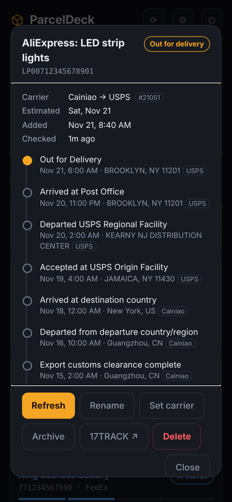
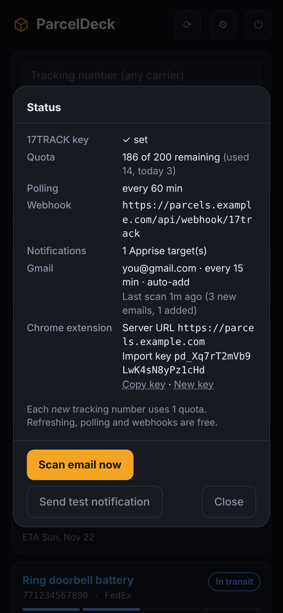
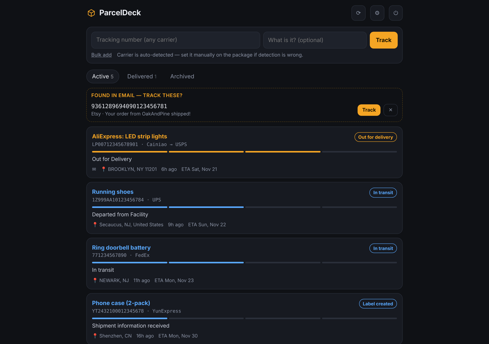
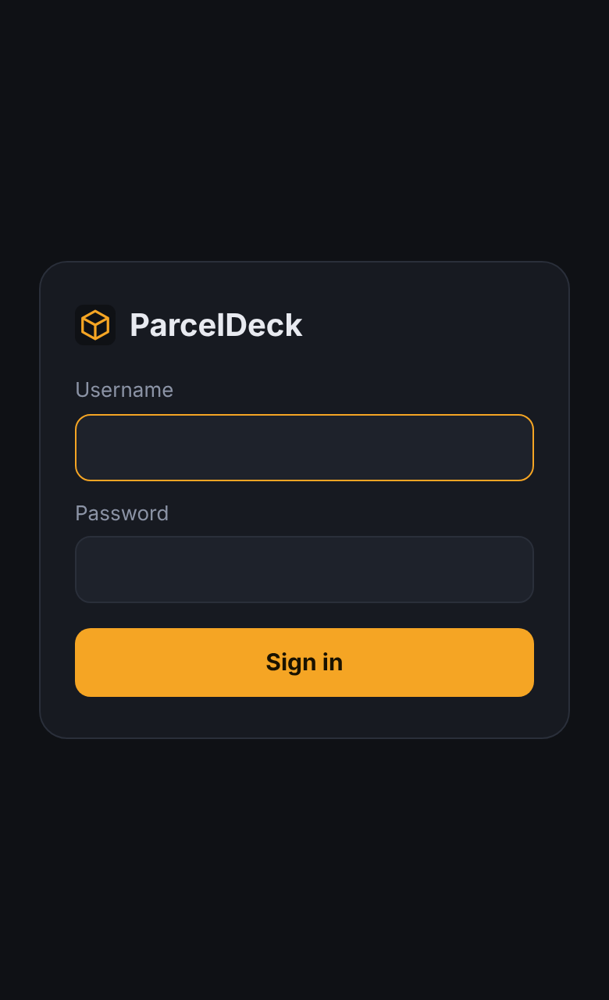
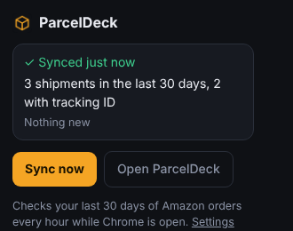
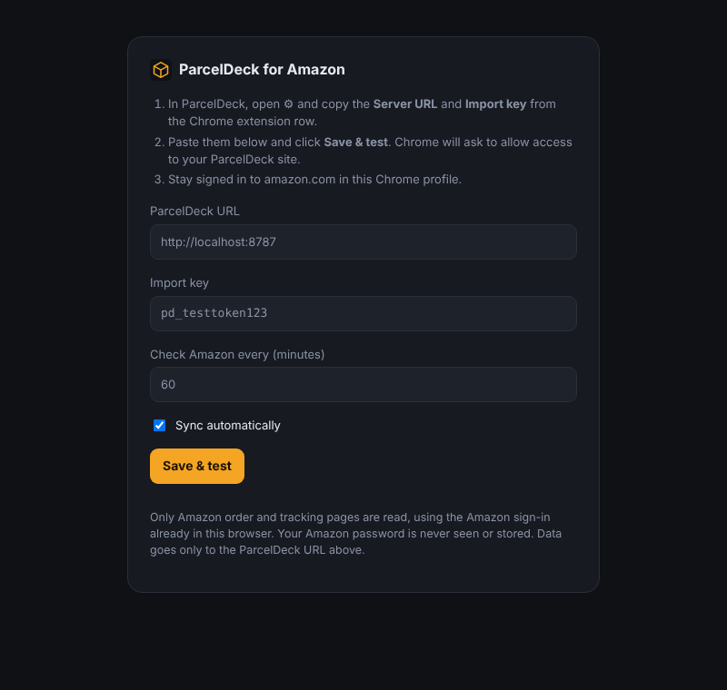

# ParcelDeck

Self-hosted package tracker for every carrier — USPS, UPS, FedEx, DHL, Amazon Logistics, OnTrac, LaserShip,
**AliExpress / Cainiao**, China Post, Yanwen, 4PX, YunExpress, Royal Mail, Canada Post and ~3,000 more.

Carrier data comes from the **17TRACK Tracking API** (one integration covers every carrier; no scrapers to
maintain). Your package list, history and notifications live in SQLite on your server.


<p align="center">
  
  
  
</p>

<p align="center">
  
</p>

Features
- Paste any tracking number → carrier auto-detected (manual override with searchable carrier list)
- Multi-leg timeline: AliExpress shipments show Cainiao + the US last-mile carrier (USPS etc.) merged
- Active / Delivered / Archived views, labels, bulk add, ETA when available
- Background polling + optional 17TRACK webhook for near-instant updates
- Amazon orders via a small Chrome extension (uses your browser's Amazon sign-in, no password stored)
- Push/email notifications on status changes via Apprise (ntfy, Pushover, Telegram, Discord, email…)
- Installable on iPhone home screen (PWA), username/password login

## Deploy on homeserv

The image is built by GitHub Actions on every push to `main` and published as
`ghcr.io/mstras/parceldeck:latest` (plus `:sha-xxxxxxx` and `:1.2.3` for `v1.2.3` tags).

```bash
mkdir -p /mnt/two/Containers/parceldeck && cd /mnt/two/Containers/parceldeck
curl -fsSLO https://raw.githubusercontent.com/mstras/ParcelDeck/main/compose.yaml
curl -fsSL https://raw.githubusercontent.com/mstras/ParcelDeck/main/.env.example -o .env
nano .env                                  # set TRACK17_API_KEY at minimum
docker compose pull && docker compose up -d
```

Update later with `docker compose pull && docker compose up -d` (or redeploy the stack in Dockhand).
To build locally instead, clone the repo and uncomment `build: .` in `compose.yaml`.

Open `http://192.168.50.229:8787`.

In Dockhand: create a stack from `/mnt/two/Containers/parceldeck/compose.yaml`.

## 17TRACK API key

1. Sign up at **https://admin.17track.net** (API account — separate from the consumer 17track.net login).
2. Settings → Security → **Access Key** → put it in `TRACK17_API_KEY`.
3. Check the quota page there for your plan. **Only registering a new number uses quota (1 per number).**
   Refreshes, polling and webhooks are free, so a free/low tier goes a long way for personal use.

## Login



Set `APP_USERNAME` and `APP_PASSWORD` in `.env` and restart. Every page and API call then requires signing in
(except `/healthz` and the 17TRACK webhook, which is protected by its signature instead).

- Sessions last `SESSION_DAYS` (default 30) and survive container restarts; sign out with ⏻ in the header.
- Changing `APP_PASSWORD` signs out every device.
- 5 wrong attempts from one IP → that IP is locked out for 15 minutes.
- The session signing key is generated once into `data/.session_secret` (or set `SESSION_SECRET`).

<br clear="right">

## Pangolin + webhook (optional, recommended)

1. Add a Pangolin resource, e.g. `parcels.strasserco.com` → `192.168.50.229:8787`.
2. If you use Pangolin auth (SSO) on it, add a **bypass rule for path `/api/webhook/*`** so 17TRACK can reach it.
3. In admin.17track.net → Settings → **Webhook**, set URL to
   `https://parcels.strasserco.com/api/webhook/17track` (API version v2.2).
4. Set `PUBLIC_URL` in `.env` so the app shows that URL on its status screen.

Webhooks are signature-verified with your API key. Without a webhook, polling every `POLL_MINUTES` still works.

## Gmail import

ParcelDeck can watch your Gmail and start tracking packages from shipping emails on its own.

1. Turn on 2-Step Verification for your Google account (if it isn't already).
2. Create an app password at https://myaccount.google.com/apppasswords (name it "ParcelDeck").
3. In `.env`: `GMAIL_ADDRESS=you@gmail.com` and `GMAIL_APP_PASSWORD=xxxx xxxx xxxx xxxx`, then
   `docker compose up -d`.
4. ⚙︎ → **Scan email now** to test. After that it scans every `EMAIL_POLL_MINUTES`.

How it works
- Connects to `imap.gmail.com` **read-only**: nothing is marked read, moved, or deleted.
- Uses Gmail search to look only at shipping-type emails from the last `EMAIL_LOOKBACK_DAYS`, and remembers
  which emails it has already checked.
- Confident numbers (UPS `1Z…`, USPS `92/93/94/95…` with check digit, AliExpress `LP…`, YunExpress `YT…`,
  Amazon `TBA…`, international postal `XX123456789CN`, numbers in carrier tracking links, numbers after
  "Tracking number:") are added automatically and labeled with the sender and subject.
- Ambiguous ones (e.g. a bare 12-digit FedEx number) appear in a **Found in email** box with Track / ✕ buttons.
- Dismissed numbers are never suggested again.

Limits: Amazon packages delivered by Amazon itself often don't include a tracking number in the email (only a link
into your Amazon account). Those can't be picked up. Google Workspace (company) accounts don't allow app passwords.
To revoke access, delete the app password in your Google account.

## Amazon (Chrome extension)

Amazon has no API for your own orders, and its shipping emails often leave out the tracking number. The
**ParcelDeck for Amazon** extension fills that gap using the Amazon sign-in already in your Chrome:

<p>
  
  
</p>

1. Download `parceldeck-extension-vX.Y.Z.zip` from the latest [release](https://github.com/mstras/ParcelDeck/releases)
   and unzip it somewhere permanent (or use the `extension/` folder of this repo).
2. Chrome → `chrome://extensions` → turn on **Developer mode** → **Load unpacked** → pick the folder.
3. The settings page opens. In ParcelDeck, ⚙︎ → *Chrome extension* row: copy the **Server URL** and **Import key**,
   paste them in, and click **Save & test** (Chrome asks to allow access to your ParcelDeck site).

What it does
- Every hour (while Chrome is open) it loads your last 30 days of orders, opens the tracking page of each
  shipment it hasn't seen yet, reads the carrier and **Tracking ID** (UPS `1Z…`, USPS, Amazon `TBA…`, …) and sends
  it to ParcelDeck labeled with the item name, with an **Amazon ↗** link back to the order.
- Already-delivered and not-yet-shipped shipments are skipped; tracking pages are only loaded once per shipment
  (max 15 per sync, a couple of seconds apart).
- Pages you open yourself on Amazon (order list, *Track package*) are imported too.
- If you're signed out of Amazon, the toolbar icon shows **!** — sign in and click *Sync now*.

Privacy & security
- The extension never sees your Amazon password and only reads amazon.com order/tracking pages.
- The import key only allows adding packages (`/api/import/*`); it can't read or change anything else.
  Make a new one any time with ⚙︎ → *New key* (or pin it with `IMPORT_TOKEN`).
- Automating your Amazon account is against Amazon's terms. The extension stays at roughly human browsing
  levels on your own browser and IP, but use it knowing that.

## Notifications

Set `APPRISE_URLS`, e.g. `ntfy://ntfy.sh/your-secret-topic` or `pover://user@token`, restart,
then ⚙︎ → *Send test notification*.

## Tips
- AliExpress: use the tracking number from the order's *Track order* page (e.g. `LP…`, `AE…`, `CN…`,
  `UB…`, `YT…`). Once the parcel is handed to USPS/UPS in the US, the last-mile events appear in the same timeline.
- If 17TRACK guesses the wrong carrier, open the package → **Set carrier**.
- Delivered packages stop polling automatically. Archive them to clean up; Delete also removes them from 17TRACK
  (quota isn't refunded).
- Data: `./data/parceldeck.db` — back it up with the rest of `/mnt/two/Containers`.

## API
`GET /api/packages?view=active|delivered|archived|all` · `POST /api/packages {number,label,carrier?}` or
`{numbers:"multi\nline"}` · `GET|PATCH|DELETE /api/packages/{id}` · `POST /api/packages/{id}/refresh` ·
`POST /api/refresh-all` · `GET /api/quota` · `GET /api/carriers?q=` · `POST /api/webhook/17track`

## Releasing
Add `release-notes/vX.Y.Z.md`, commit, then `git tag vX.Y.Z && git push origin vX.Y.Z`.
The workflow builds `ghcr.io/mstras/parceldeck:X.Y.Z` and publishes the GitHub release with those notes.
